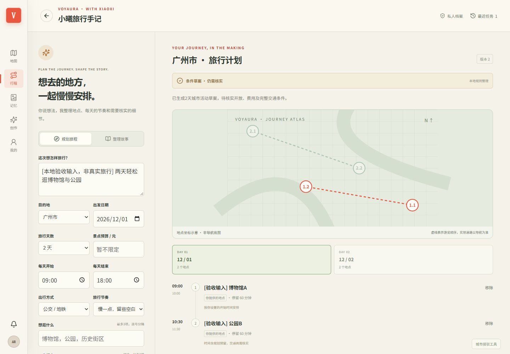

# Voyaura

**Plan the journey. Shape the story.**

以地图与私人旅行记忆为核心，提供带来源、约束检查和明确确认的旅行工作流。本开发分支保留原Vue3/FastAPI/SQLAlchemy/PostgreSQL/Redis/MinIO体系，增加小曦行程与故事工作台。

## 目前实际可验证的能力

- 文字目标＋明确城市/日期/节奏/预算 → 用户地点或已授权高德查询 → 按天组织＋时间线＋独立检查 → 编辑 → 内容绑定确认 → 私有档案。
- 主动授权所选城市与日期的已有记录 → 本地整理文字/日期/可用媒体数量 → 可编辑故事 → 再确认保存。没有记录就提示信息不足，不编造经历。
- 单机owner令牌保护全部业务API，持久化任务/错误/版本/确认，重复请求与并发确认幂等；运行中断有界失败。
- 真实SQLite迁移、桌面/手机浏览器验证、现有城市记忆和媒体流水线回归。媒体完整服务仍需实际Provider联调。

默认有限规则理解，不宣称通用大模型Agent。可选DeepSeek仅提检索关键词；无云凭证时来源和未知条件明确保留，示意连线不是导航路线。完整约束k-medoids/ILS、语音、长期画像、RAG、票务与多人生产账号不在本次完成范围。



## 开始运行

完整命令、端口、测试及部署边界见 **[RUNBOOK.md](RUNBOOK.md)**。

```powershell
uv venv api/.venv --python 3.12
uv pip install --python api/.venv/Scripts/python.exe --default-index https://pypi.org/simple --require-hashes -r api/requirements-dev.lock
npm --prefix web ci
api/.venv/Scripts/python.exe scripts/local_setup.py
```

两个终端分别执行 `api/.venv/Scripts/python.exe scripts/local_serve.py api` 和 `api/.venv/Scripts/python.exe scripts/local_serve.py web`。打开 `http://127.0.0.1:5188`，使用本机 `.local/access-token.txt` 中的令牌连接。不要提交或分享令牌。

本地默认API8018/Web5188，仅监听127.0.0.1。交付时默认profile为新的clean-start.db，没有旅行足迹；早期样例库完整保留，隔离浏览器运行器不读改个人profile。

## 工程与交付

- [ARCHITECTURE_REVIEW.md](ARCHITECTURE_REVIEW.md)：原立项书对照、基线证据、问题及优先级。
- [AGENTS.md](AGENTS.md)、[PLAN.md](PLAN.md)、[PROGRESS.md](PROGRESS.md)：协作规则、里程碑、真实进度。
- **[交付索引](docs/delivery/README.md)**：最终架构、测试报告、技术报告、PPT大纲、Demo与CodeArts方案。
- [接口契约](docs/agent_contract.md)：Agent API、输入、来源、确认及边界。
- `api/`：API/测试/迁移/哈希锁；`web/`：Vue工作台/单元测试/Playwright；`scripts/`：本地初始化与隔离验收。
- `infra/`、`worker/`：既有完整媒体部署；`docx/`：原产品与媒体配置文档。

验证：在api运行pytest和ruff；在web运行test和build。根目录 `api/.venv/Scripts/python.exe scripts/verify_e2e.py` 会自动创建隔离测试数据库并跑桌面/手机真实HTTP浏览器链路。样例明确标为软件验收输入。CI已定义，未冒称远程运行成功。

## 既有媒体体系

保留签名上传、配额/文件复核、扫描后可见、WebP缩略图与视频封面、工作台风格/历史/收藏/对比、ComfyUI适配、确定性中文印章与授权小曦透明素材合成。真实存储、扫描器、ffmpeg、workflow及授权角色素材需分别配置并验收；未配置时保持禁用或明确失败。原媒体队列可靠交付与跨存储删除补偿仍需改良。

GC Minimal Zine Poster recipe来源、MIT许可及上游使用边界见 [THIRD_PARTY_NOTICES.md](THIRD_PARTY_NOTICES.md)。本项目不分发上游示例图片。

## 参赛事实

本次工作由Codex完成，**没有生成虚构CodeArts证明**。华为比赛要求码道作为核心AI编程工具；必须按交付中的真实工作与留证方案补齐，并核实混合工具口径。真实云Provider与多人生产化仍单列验收。本任务未推送、合并、公开部署或上传参赛作品。
